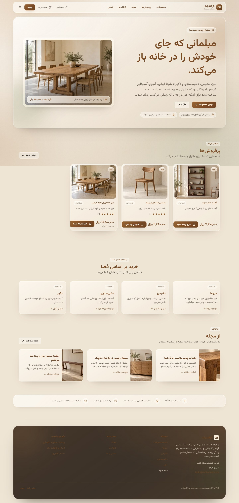

# Rootwood Group · روت‌وود گروپ

A production-ready Persian woodworking atelier e-commerce project with an elegant **RTL static storefront** built in **Vite + React 19** and a **hardened, secure REST API in PHP 8.2+ & MySQL 8.0**.

> **Stack:** Vite · React 19 · TypeScript · Tailwind CSS 4 · Wouter · PHP 8.2+ · PDO · MySQL 8.0 · Docker Compose



---

## 🌟 Highlights & Architecture

### 1. Static Vite Frontend (`apps/web`)
- **100% Static HTML/CSS/JS**: Compiles directly to `apps/web/dist` with zero Node.js server runtime required in production. Can be deployed to standard cPanel `public_html`, Nginx, Cloudflare Pages, Netlify, or S3.
- **Client-Side Routing**: Powered by lightweight, fast `wouter` router.
- **RTL & Persian Atelier Design**: Native right-to-left layout, Vazirmatn typography, Toman currency formatting, and Jalali date conversions.
- **Interactive Catalog**: Real-time faceted search, category filtering, wood species filtering, price range, and sorting.
- **Cart & Session**: Guest carts identified by `X-Cart-Session` and merged atomically into customer accounts upon login.
- **Customer Portal**: Order tracking with Jalali timestamps, address book CRUD, and password security.
- **Atelier Admin Panel (`/admin`)**: Role-gated dashboard with revenue KPIs, order status management, review moderation, and bespoke furniture inquiry triage.

### 2. Hardened PHP + MySQL Backend (`backend/`)
- **Zero Composer Bloat**: Uses native PHP 8+ extensions (`pdo`, `pdo_mysql`, `curl`, `json`, `hash`, `random_int`).
- **Security Hardening**:
  - **Cryptographic OTP**: 6-digit `random_int()`, HMAC-SHA256 hashed in database, 120s TTL, max 5 attempts, max 5 sends per 10m window. Code is never returned in production.
  - **Server-Side Pricing**: Prices are fetched authoritatively from the database during order creation; client pricing cannot be tampered with.
  - **Atomic Stock Management**: `UPDATE products SET stock = stock - ? WHERE id = ? AND stock >= ?` executed inside MySQL transactions. Order cancellations safely restore stock.
  - **IDOR Protection**: All customer orders and addresses enforce strict ownership checks (`order.user_id === user.id`).
  - **Payment Gateways**: Native integration with **Zarinpal** and **Zibal** with server-side amount checks (Toman to Rial `* 10` boundary conversion). Simulation gateway is restricted to non-production environments.
  - **Review Moderation Queue**: Customer reviews are saved with `approved = 0` until vetted by an atelier administrator.
  - **Strict CORS & Headers**: `X-Content-Type-Options: nosniff`, `X-Frame-Options: SAMEORIGIN`, and explicit origin validation.

---

## 📁 Repository Layout

```text
.
├─ apps/
│  └─ web/                     # Vite + React 19 Static Frontend
│     ├─ src/                  # App routes, components, contexts, and API client
│     │  ├─ routes/            # Home, Products, ProductDetail, Cart, Checkout, Account, Admin...
│     │  ├─ components/        # SiteHeader, SiteFooter, AuthDialog, CartDialog, ProductCard...
│     │  └─ lib/               # api.ts (typed client), price.ts (Toman & Jalali formatters)
│     ├─ public/               # Static assets & WebP product photography
│     ├─ index.html            # Persian RTL HTML5 template with Vazirmatn font
│     ├─ vite.config.ts        # Vite config with /api proxy to PHP backend
│     └─ dist/                 # Production static build output
├─ backend/                    # Hardened PHP 8.2+ REST API
│  ├─ index.php                # Master router
│  ├─ config.php               # Environment configuration (.env loader)
│  ├─ db.php                   # Singleton PDO connection (PDO::ATTR_EMULATE_PREPARES => false)
│  ├─ jwt.php                  # Pure PHP HMAC-SHA256 JWT implementation
│  ├─ otp.php                  # Cryptographic OTP generation & verification
│  ├─ catalog.php              # Products, categories, facets, and search
│  ├─ cart.php                 # Guest & authenticated cart management
│  ├─ orders.php               # Transactional order creation & stock decrements
│  ├─ payment.php              # Zarinpal, Zibal, and dev simulation handlers
│  ├─ admin.php                # Role-gated dashboard KPIs, order triage, and reviews
│  ├─ reviews.php              # Moderated product reviews
│  ├─ blog.php                 # Workshop magazine and journal
│  ├─ contact.php              # General inquiries and bespoke furniture commissions
│  ├─ addresses.php            # Customer address book CRUD
│  ├─ schema.sql               # MySQL 8.0 DDL schema (14 tables, InnoDB, utf8mb4)
│  ├─ seed.php                 # Persian atelier seed script
│  ├─ .htaccess                # Apache URL rewriting & security headers
│  └─ .env.example             # Backend environment template
├─ docker-compose.yml          # Containerized PHP 8.2-Apache + MySQL 8.0 environment
└─ package.json                # Monorepo scripts
```

---

## 🚀 Quick Start

### Option A: Using Docker Compose (Recommended)

1. **Start the PHP + MySQL containers**:
   ```bash
   docker compose up -d
   ```
   - API will be accessible at: `http://localhost:8000/api`
   - MySQL 8.0 database will initialize automatically with `backend/schema.sql` on port `3307`.

2. **Populate the demo seed**:
   ```bash
   docker exec -it rootwood_api php /var/www/html/api/seed.php
   ```

3. **Run the Vite frontend in development**:
   ```bash
   pnpm install
   pnpm dev
   ```
   Open `http://localhost:5173` in your browser. Requests to `/api` are automatically proxied to `http://localhost:8000`.

---

### Option B: Local PHP & MySQL

1. **Setup MySQL**:
   Create a database `rootwood` and import `backend/schema.sql`:
   ```bash
   mysql -u root -p rootwood < backend/schema.sql
   ```

2. **Configure backend `.env`**:
   ```bash
   cp backend/.env.example backend/.env
   ```
   Update `DB_HOST`, `DB_NAME`, `DB_USER`, and `DB_PASS`.

3. **Run seed**:
   ```bash
   php backend/seed.php
   ```

4. **Start PHP built-in server**:
   ```bash
   php -S 127.0.0.1:8000 -t backend
   ```

5. **Start Vite frontend**:
   ```bash
   pnpm dev
   ```

---

## 📦 Production Static Build & Deployment

### 1. Build the Static Frontend
```bash
pnpm --filter web build
```
The compiled static assets are generated in `apps/web/dist`:
- `index.html`
- `assets/index-*.js`
- `assets/index-*.css`
- `images/*`

### 2. Deploy to Shared Hosting / cPanel
1. Copy the contents of `apps/web/dist/` into your server's `public_html/`.
2. Copy the `backend/` directory to `public_html/api/` (or a subfolder of your choice).
3. Ensure `.htaccess` is present in both `public_html/` (for SPA client routing) and `public_html/api/` (for PHP API rewriting).
4. Create a MySQL database in cPanel and import `backend/schema.sql`.
5. Create `public_html/api/.env` with your production database credentials, a 32+ character `JWT_SECRET`, and payment gateway merchant keys.

---

## 👤 Demo Accounts

The seed script initializes the following demo credentials:

| Role | Email / Phone | Password |
| --- | --- | --- |
| **Admin** | `hello@craftedroot.com` | `CraftedRoot!2026` |
| **Customer** | `arash@craftedroot.com` | `CraftedRoot!2026` |
| **Customer** | `09123456789` | OTP Login (`123456` in dev mode) |

---

## 🧪 Verification & Typechecking

```bash
# Typecheck Vite frontend
pnpm typecheck

# Build static bundle
pnpm build
```

---

## ⚖️ License
MIT License. Crafted with passion for Persian woodworking and modern web engineering.
