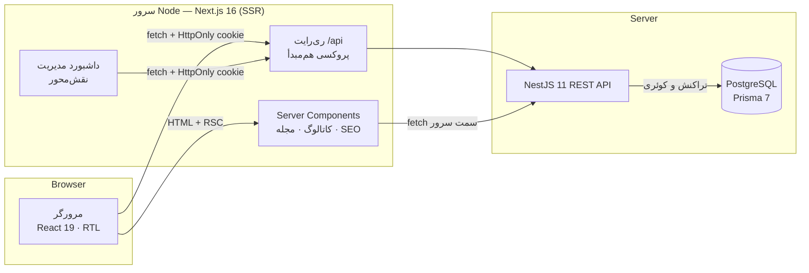
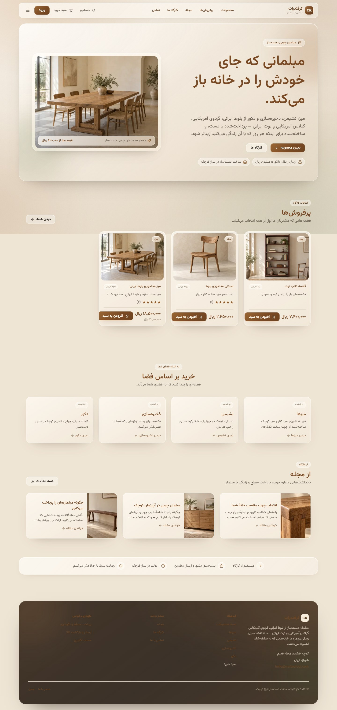
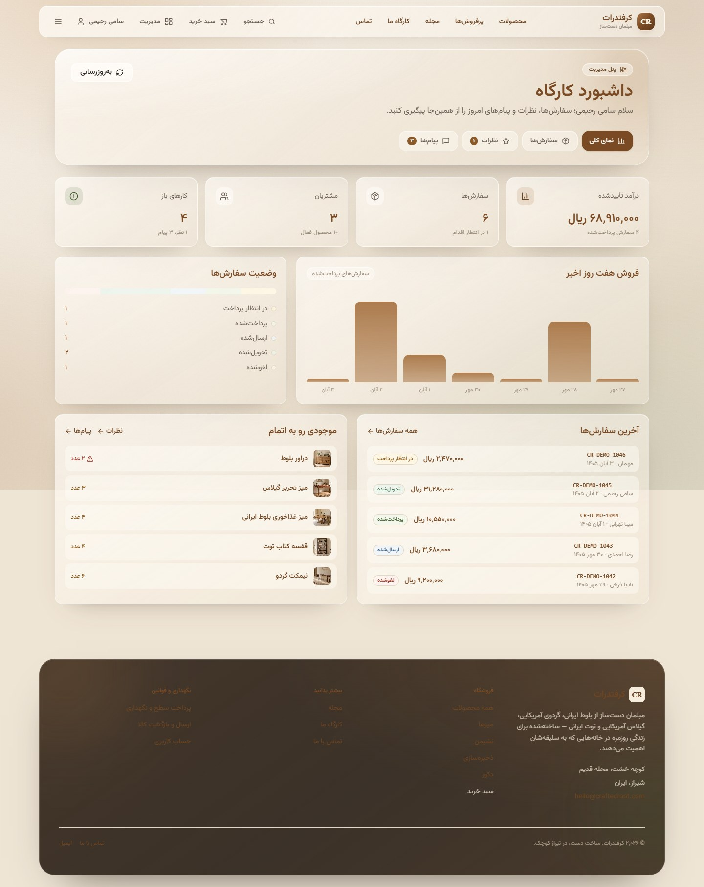
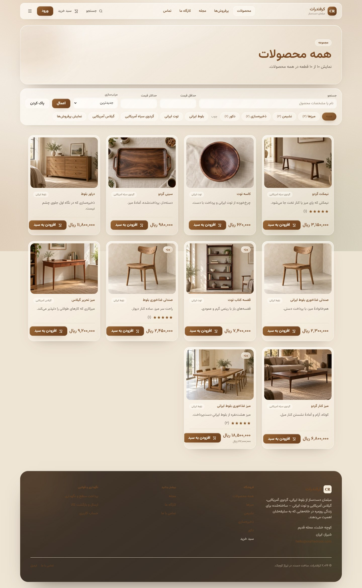
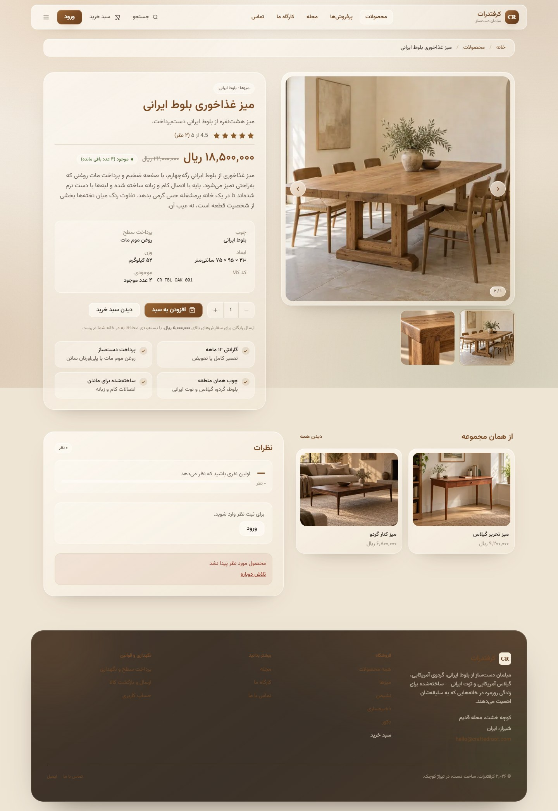
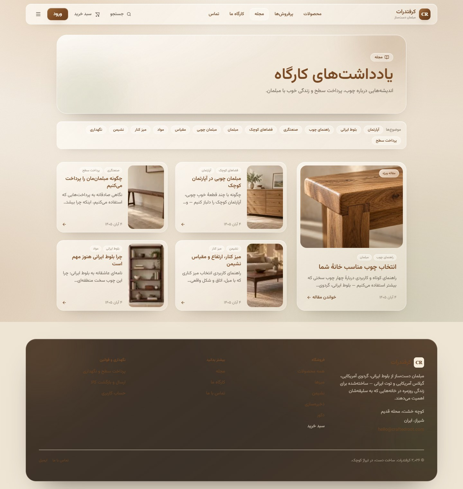
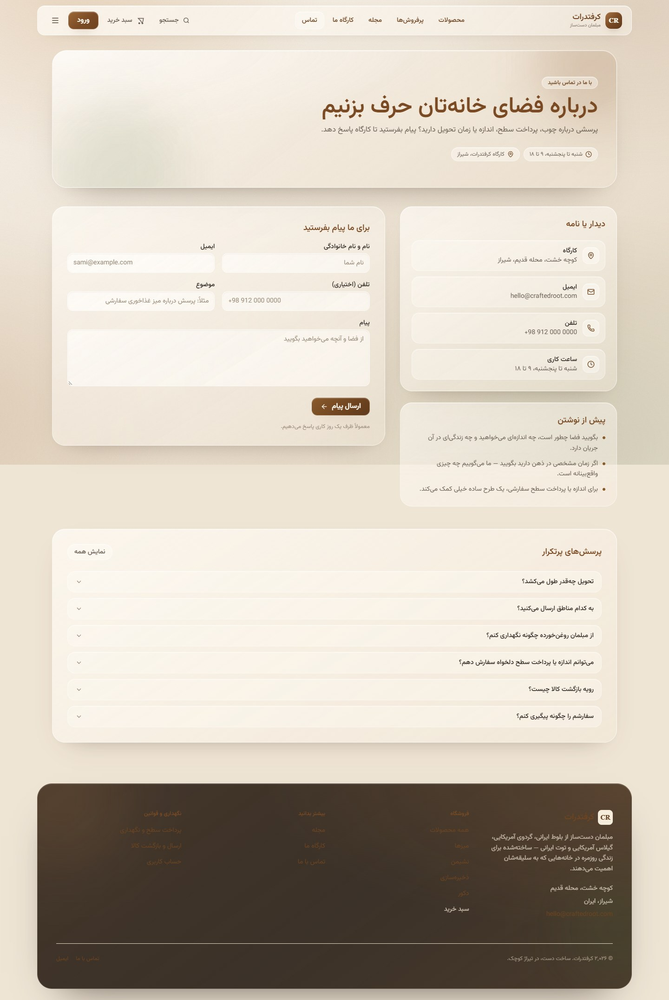
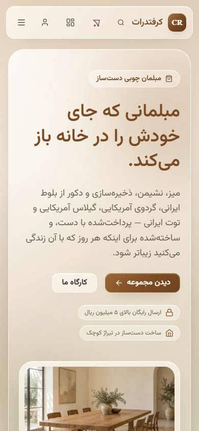

# CraftedRoot؛ از یک ویترین زیبا به یک فروشگاه قابل‌اداره

این سند روایت تصمیم‌های محصولی و فنی پروژهٔ **CraftedRoot** است: یک فروشگاه اینترنتی نمونه برای یک کارگاه کوچک مبلمان دست‌ساز. هدف پروژه فقط نمایش یک صفحهٔ فرود خوش‌رنگ نبود؛ می‌خواستم چرخهٔ کامل یک کسب‌وکار کوچک را در قالبی قابل اجرا، قابل تست و قابل ارائه نشان بدهم.

- دموی تصویری: [صفحهٔ اصلی](screenshots/01-home-desktop.jpg) · [داشبورد مدیریت](screenshots/06-admin-dashboard.jpg)
- مستندات اجرا و راه‌اندازی: [README](../README.md)

---

## ۱. مسئله

فروشگاه‌های نمونه‌کار معمولاً در یکی از دو نقطه متوقف می‌شوند: یا یک لندینگ زیبا با سبد خرید شبیه‌سازی‌شده، یا یک CRUD خشک بدون هویت بصری. هیچ‌کدام نشان نمی‌دهند که یک کارگاه واقعی با چه مسائلی روبه‌روست:

- مشتری باید بدون ثبت‌نام خرید کند و بعداً سبدش را به حسابش منتقل کند.
- موجودی محدود است؛ دو سفارش هم‌زمان نباید یک قطعه را بفروشند.
- نظر مشتری فقط وقتی معتبر است که خرید انجام شده باشد، و انتشار آن نیاز به تأیید کارگاه دارد.
- صاحب کارگاه باید سفارش‌ها، وضعیت ارسال، موجودی کم، نظرات در انتظار و پیام‌های پشتیبانی را در یک جا ببیند.
- محتوای مجله بخشی از قیف فروش است، نه یک صفحهٔ تزئینی.

CraftedRoot برای پوشش همین حلقه ساخته شد.

## ۲. اهداف و معیارهای پذیرش

| هدف | معیار سنجش |
| --- | --- |
| تجربهٔ واقعی مشتری | جستجو، فیلتر، سبد مهمان، تسویه، پیگیری سفارش و نظر تأییدشده |
| ادارهٔ واقعی فروشگاه | داشبورد KPI، مدیریت سفارش و موجودی، صف نظرات و تیکت‌ها |
| فارسی و راست‌به‌چپ اصیل | چیدمان RTL، تاریخ جلالی، اعداد فارسی، فونت وزیرمتن |
| امنیت قابل دفاع | کوکی HttpOnly، کنترل نقش، جلوگیری از IDOR، اعتبارسنجی ورودی |
| کیفیت قابل اثبات | تست API و مرورگر، صفر خطای WCAG A/AA، هدرهای امنیتی |
| اجرای ساده | یک `pnpm install`، یک دیتابیس، یک seed idempotent و دو دستور اجرا |

## ۳. معماری

مرورگر با `/api` روی همان مبدأ صحبت می‌کند و Next.js درخواست را به NestJS می‌رساند؛ بنابراین کوکی‌ها first-party می‌مانند. Server Componentها مستقیماً و از شبکهٔ داخلی با API حرف می‌زنند.

### چرا monorepo؟

- کد وب و API در یک مخزن، اما با وابستگی‌ها و چرخهٔ انتشار مستقل.
- قراردادهای مشترک (مدل محصول، سفارش، وضعیت‌ها) در یک نگاه قابل ردیابی است.
- CI می‌تواند هر دو برنامه را جداگانه بسازد و تست کند.
- برای نمونه‌کار، بررسی‌کننده با یک clone به کل داستان دسترسی دارد.

### مرز سرور و کلاینت

صفحات کاتالوگ، مقاله و جزئیات محصول **Server Component** هستند تا HTML اولیه سریع باشد و SEO سالم بماند. جستجو، فیلتر، مرتب‌سازی و صفحه‌بندی کاتالوگ و مجله از پارامترهای URL خوانده و در سرور اعمال می‌شوند؛ پس هر نتیجه لینک‌شدنی و قابل ایندکس است و بدون جاوااسکریپت هم کار می‌کند. تعامل‌ها (سبد، احراز هویت، دیالوگ‌ها، فرم‌ها) کامپوننت کلاینت‌اند. داده‌های شخصی هیچ‌وقت در کش عمومی Next نمی‌مانند.

## ۴. تصمیم‌های کلیدی

### ۴.۱. احراز هویت با کوکی HttpOnly، نه توکن در localStorage

**مشکل:** توکن در localStorage در برابر XSS آسیب‌پذیر است و هر اسکریپت تزریق‌شده می‌تواند آن را بخواند.

**تصمیم:** JWT کوتاه‌عمر در کوکی `HttpOnly` و `SameSite=Lax` قرار می‌گیرد. علاوه بر آن، فیلد `tokenVersion` روی کاربر نگه داشته می‌شود؛ خروج و تغییر رمز، نسخه را بالا می‌برد و تمام توکن‌های قبلی باطل می‌شوند.

**معامله:** استقرار در دو دامنهٔ متفاوت نیازمند `SameSite=None` و HTTPS است. این تنظیمات مستند شده‌اند و به‌صورت آگاهانه از پیش‌فرض امن‌تر جدا می‌شوند.

### ۴.۲. سبد مهمان و ادغام در لحظهٔ ورود

**مشکل:** اجبار به ثبت‌نام پیش از خرید، نرخ تبدیل را پایین می‌آورد.

**تصمیم:** سبد مهمان به یک شناسهٔ نشست معتبر گره می‌خورد. هنگام ورود، سبد مهمان با سبد حساب ادغام می‌شود؛ تعداد اقلام جمع می‌شود، نه اینکه یکی جای دیگری را بگیرد. مالکیت سبد همیشه سمت سرور بررسی می‌شود.

**معامله:** مدیریت دو نوع مالکیت (کاربر/نشست) پیچیدگی بیشتری از یک سبد ساده دارد، اما تجربهٔ خرید واقعی‌تری می‌سازد.

### ۴.۳. موجودی و سفارش در تراکنش

**مشکل:** دو خرید هم‌زمان از آخرین قطعه نباید هر دو موفق شوند.

**تصمیم:** کاهش موجودی و ساخت سفارش در یک تراکنش Prisma انجام می‌شود. تغییر وضعیت سفارش با یک ماشین حالت سمت سرور اعتبارسنجی می‌شود؛ لغو سفارش، موجودی را دقیقاً یک‌بار برمی‌گرداند. قیمت واحد و نام محصول در آیتم سفارش snapshot می‌شوند تا تغییر بعدی کاتالوگ، فاکتور گذشته را عوض نکند.

**معامله:** تراکنش‌های طولانی‌تر و نیاز به مراقبت در ترتیب قفل‌ها؛ در عوض، oversell و موجودی منفی حذف می‌شود.

### ۴.۴. نظر تأییدشده، نه نظر آزاد

**مشکل:** نظرات بی‌اعتبار، اعتماد مشتری را از بین می‌برند.

**تصمیم:** ارسال نظر نیازمند خرید تطبیق‌پذیر است. هر نظر ابتدا در وضعیت «در انتظار» قرار می‌گیرد و فقط پس از تأیید مدیر منتشر می‌شود. محتوای ورودی با `sanitize-html` پاک‌سازی می‌شود.

**معامله:** مدیر باید صف بررسی داشته باشد؛ همین صف در داشبورد نمایش داده می‌شود و بخشی از داستان محصول است.

### ۴.۵. رندر سمت سرور به‌جای خروجی استاتیک

**تصمیم:**

- کاتالوگ و مجله در هر درخواست سمت سرور رندر می‌شوند و فیلتر/جستجو/صفحه‌بندی را از URL می‌گیرند.
- جزئیات محصول و مقاله برای سرعت، به‌صورت استاتیک با ISR کوتاه تولید می‌شوند.
- سبد، سفارش، حساب و داشبورد بدون کش هستند.

**دلیل:** خروجی استاتیک برای جستجوی واقعی کاتالوگ کافی نیست: نتیجهٔ فیلتر باید لینک‌شدنی و قابل ایندکس باشد، نه اینکه فقط در حافظهٔ مرورگر ساخته شود. SSR این کار را بدون قربانی‌کردن سرعت اولیه انجام می‌دهد و دادهٔ شخصی را هم از کش عمومی جدا نگه می‌دارد. هزینهٔ آن نیاز به یک هاست Node است، نه هاست اشتراکی ساده.

### ۴.۶. فارسی و راست‌به‌چپ به‌عنوان پیش‌فرض، نه وصله

- `lang="fa"` و `dir="rtl"` روی ریشه
- فونت وزیرمتن با `next/font/google` و خودمیزبانی
- تاریخ جلالی و اعداد فارسی در سراسر رابط
- استفاده از ویژگی‌های منطقی CSS (`start`/`end`) به‌جای `left`/`right`
- طراحی دیالوگ‌ها با تلهٔ فوکوس، بستن با Escape و بازگشت فوکوس

### ۴.۷. دسترس‌پذیری به‌عنوان تست، نه آرزو

در جریان توسعه، axe-core چند خطای واقعی پیدا کرد:

- `aria-prohibited-attr` روی `
`های ستارهٔ امتیاز → با `role="img"` برطرف شد.
- `dlitem` برای `<dt>/<dd>`های خارج از `<dl>` → ساختار معنایی اصلاح شد.

نتیجهٔ فعلی: **صفر خطای WCAG 2.0/2.1 سطح A/AA** در تمام صفحات اصلی، دیالوگ ورود و داشبورد مدیریت.

### ۴.۸. تصاویر محلی و بهینه

تصاویر محصولات با هوش مصنوعی تولید و به WebP تبدیل شده‌اند و به‌صورت محلی در مخزن قرار دارند. مزایا:

- دمو بدون وابستگی به سرویس تصویر خارجی کار می‌کند.
- `next/image` اندازه و فرمت را بهینه می‌کند.
- تصاویر بالای صفحه `priority` دارند و بقیه lazy بارگذاری می‌شوند.

### ۴.۹. تست و CI

- **Jest + Supertest**: ۲۸ تست API روی دیتابیس ایزولهٔ `_test`؛ تست‌های مالکیت، نقش، گذار وضعیت، موجودی، پرداخت و OTP.
- **Playwright + axe**: تست‌های مرورگر شامل فروشگاه، احراز هویت، داشبورد، هدرهای امنیتی و دسترس‌پذیری.
- **GitHub Actions**: چهار job مستقل برای کیفیت کد، تست API، تست مرورگر و build تولیدی.

یک جزئیات مهم: ابزار ساخت دیتابیس تست، نام دیتابیس را بررسی می‌کند و اگر به `_test` ختم نشود، اجرا را متوقف می‌کند. این محافظ ساده از پاک شدن دادهٔ توسعه جلوگیری می‌کند.

### ۴.۱۰. پرداخت واقعی و تأیید سمت سرور

**مشکل:** اگر وضعیت پرداخت از پارامتر URL یا پاسخ کلاینت خوانده شود، هر کاربر می‌تواند سفارش را «پرداخت‌شده» کند.

**تصمیم:** درگاه‌های زرین‌پال و زیبال پیاده شده‌اند. جریان پرداخت سه محافظ دارد:

- مبلغ و مالکیت سفارش پیش از شروع پرداخت بررسی می‌شود.
- آدرس بازگشت فقط از `NEXT_PUBLIC_SITE_URL` ساخته می‌شود؛ callback دلخواه کلاینت نادیده گرفته می‌شود.
- نتیجهٔ نهایی همیشه از خود درگاه استعلام می‌شود و گذار به `PAID` داخل یک تراکنش و فقط یک‌بار انجام می‌شود.

درگاه شبیه‌سازی‌شده فقط وقتی فعال است که `PAYMENT_SIMULATION=true` باشد و `NODE_ENV` برابر `production` نباشد؛ بنابراین build تولیدی هرگز بدون درگاه واقعی سفارش را پرداخت‌شده علامت نمی‌زند. مبالغ در دیتابیس به تومان ذخیره می‌شوند و تبدیل به ریال فقط یک‌بار، در لایهٔ پرداخت، انجام می‌شود.

### ۴.۱۱. کد یک‌بار مصرف مبتنی بر دیتابیس

**مشکل:** کد ثابت `12345` یا نگه‌داشتن کد در حافظهٔ پروسه، هم ناامن است و هم با ری‌استارت یا چند نمونه از کار می‌افتد.

**تصمیم:** جدول `OtpCode` کدها را به‌صورت HMAC-SHA256 ذخیره می‌کند. کد شش‌رقمی با `crypto.randomInt` ساخته می‌شود، دو دقیقه اعتبار دارد، حداکثر پنج بار قابل امتحان است، حداکثر پنج بار در ده دقیقه برای هر شناسه ارسال می‌شود و پس از استفاده یا ارسال مجدد باطل می‌شود. در تولید، کد هرگز در پاسخ API برنمی‌گردد؛ اگر کانال پیامک/ایمیل پیکربندی نشده باشد، درخواست با خطای صریح رد می‌شود.

## ۵. چالش‌ها و راه‌حل‌ها

### کوکی در تست مرورگر

Playwright دو سرور مستقل (وب روی ۳۱۰۰ و API روی ۳۱۰۱) را اجرا می‌کند. اگر یکی `localhost` و دیگری `127.0.0.1` باشد، مرورگر آن‌ها را دو سایت متفاوت می‌داند و کوکی `SameSite=Lax` ارسال نمی‌شود. هر دو روی `127.0.0.1` تنظیم شدند تا کوکی در تست‌ها همان رفتار تولید را داشته باشد.

### تست‌های شکننده در برابر تصاویر تنبل

عکس‌های پایین صفحه تا اسکرول نشوند بارگذاری نمی‌شوند و انتظار برای `networkidle` کافی نیست. یک helper مشترک اضافه شد که صفحه را تا انتها اسکرول می‌کند، به `document.fonts.ready` و تکمیل تصاویر منتظر می‌ماند و در بدترین حالت با یک timeout کوتاه رها می‌شود. همین موضوع از معطلی دو دقیقه‌ای یک تست جلوگیری کرد.

### اسکرین‌شات‌های قابل ارائه

- نشانگر توسعهٔ Next در تصاویر دیده می‌شد → با متغیر محیطی و تنظیم `devIndicators` خاموش شد.
- اسکرول نرم CSS اجازهٔ بازگشت فوری به بالای صفحه را نمی‌داد → اسکرول موقتاً `auto` شد.
- ورود مدیر با `request` جداگانه کوکی مرورگر را به اشتراک نمی‌گذاشت → ورود از طریق خود رابط انجام شد.

### دادهٔ دموی معنادار

نمودار هفت‌روزهٔ داشبورد وقتی همهٔ سفارش‌ها یک‌روزه بودند، خالی به نظر می‌رسید. تاریخ سفارش‌های seed روی شش روز اخیر توزیع شد تا داشبورد در تصویر و دمو، فعالیت واقعی نشان دهد.

### هشدار LCP در محیط توسعه

هشدار Next دربارهٔ تصویر LCP در dev تا حدی ناشی از ردیابی `src` مشترک بین نسخهٔ priority و lazy است. با این حال، تصاویر ردیف اول کاتالوگ و مقالهٔ ویژه هم `priority` گرفتند تا رفتار تولیدی درست باشد. این هشدارها در build تولیدی وجود ندارند.

## ۶. نتیجه

- چرخهٔ کامل خرید مهمان تا سفارش ثبت‌شده و نظر تأییدشده
- داشبورد عملیاتی با نمودار فروش، صف نظرات و تیکت‌ها
- صفر خطای WCAG A/AA در تست خودکار
- هدرهای امنیتی و `/health` با بررسی اتصال دیتابیس
- ۲۸ تست API و تست‌های مرورگر، همه سبز
- build تولیدی وب و API و چهار job CI

### گالری

| فروشگاه | داشبورد |
| --- | --- |
|  |  |

| کاتالوگ | جزئیات محصول |
| --- | --- |
|  |  |

| مجله | تماس |
| --- | --- |
|  |  |

## ۷. محدودیت‌ها و گام‌های بعدی

- **درگاه‌های پرداخت واقعی متصل شده‌اند** (زرین‌پال و زیبال) با تأیید سمت سرور و idempotency؛ برای استفادهٔ واقعی فقط credential تولیدی لازم است.
- **ایمیل تراکنشی** با Resend پیاده شده است؛ پیامک نیز از طریق کاوه‌نگار ارسال می‌شود. اعلان ایمیلی سفارش (فراتر از OTP) گام بعدی است.
- **محدودیت نرخ در حافظه است.** برای چند نمونهٔ API، throttler مبتنی بر Redis لازم است.
- **پیکربندی بصری محصول (P6)** هنوز پیاده نشده؛ این قابلیت می‌تواند انتخاب چوب، ابعاد و پرداخت سطح را به سفارش متصل کند.
- **آزادسازی موجودی سفارش‌های PENDING رهاشده** هنوز خودکار نیست؛ یک job زمان‌بندی‌شده لازم است.
- تصاویر محصولات تولیدشده با هوش مصنوعی‌اند و برای نمایش نمونه‌کار استفاده می‌شوند، نه عکاسی واقعی کارگاه.

---

اگر این پروژه را بررسی می‌کنید، پیشنهاد می‌کنم از مسیر «تور بازدیدکننده» در [README](../README.md#reviewer-tour) شروع کنید: افزودن به سبد بدون ورود، ادغام سبد پس از ورود، تسویه، و سپس مدیریت سفارش و صف نظرات در داشبورد.
